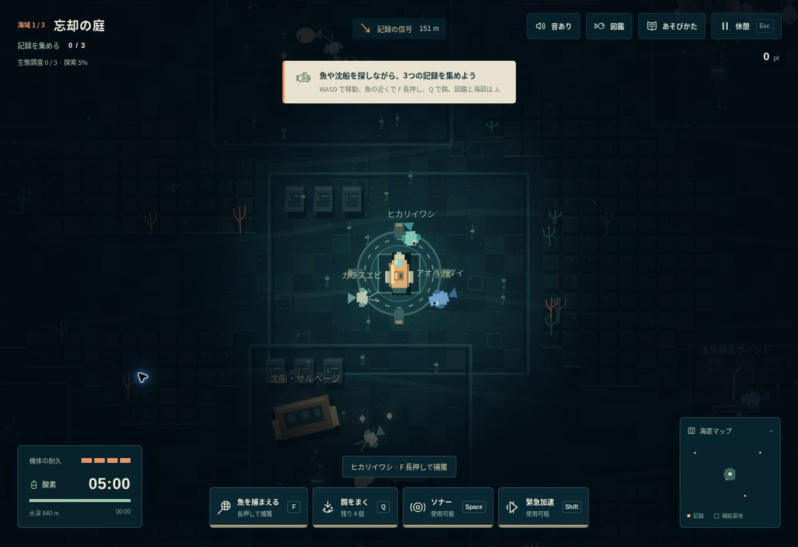

# NULL TIDE — 深層の記録

音で闇を読み、沈んだ街の記録を持ち帰る海底探索ゲーム。ブラウザだけで遊べます。

**[ゲームを遊ぶ](https://knutkning.vercel.app)**



## 探索・捕獲アップデート (v2.0)

- マップは `123 × 89` タイル。従来の `73 × 53` に対して面積約2.83倍。各海域21地点を、分岐と回遊路でつなぎます。
- 海域ごとに63匹の生きものが泳ぎます。全8種類の架空の生きものには、泳ぐ速さ・希少性・捕獲時間の違いがあります。
- 静かに近づいて F を長押し。ソナー・急加速・速い接近で魚が驚くと捕まえられません。Q の餌で落ち着かせておびき寄せられます。
- 捕獲した種類と数は生きもの図鑑に保存。潜航失敗や再読み込み後も、このブラウザに残ります。
- 各海域で3匹捕獲すると生態調査の依頼達成。650pt、餌2個、酸素40秒が手に入ります。
- 沈船や生態調査ポイントは E 長押し。餌・酸素・修理・海図の更新を得られます。各地点の報酬は一度だけ。
- 海図は移動とソナーで埋まります。J で図鑑と大きな海図を開けます。開いている間は一時停止します。
- 酸素タンクは5分。中央の基地で酸素と耐久を繰り返し補給でき、寄り道してから記録回収へ向かえます。

## ゲーム

ソナーは海底施設を一時的に照らします。同時に、その音を聞いた監視機が近づいてきます。機体の慣性と加速を使い分け、酸素が尽きる前に各海域の3つの記録を回収し、中央の帰還点に戻ってください。

- 全3海域「忘却の庭」「沈黙の街」「記憶の底」。毎回異なる、接続を保証した生成マップ。
- ソナーに反応する監視機、障害物を迂回する経路探索、接近時の追跡。
- 無敵時間付きの緊急加速。監視機に接触すると一時停止させられます。
- 記憶のかけら、酸素供給装置、回収中の危険を伴う長押し操作。
- 海域間でエンジン・ソナー・酸素タンクの強化を選択。強化は重ねがけ可能。
- 独自のピクセル描画、水中光、ソナー波、パーティクル、Web Audio による環境音と効果音。
- スマホ用スティックとボタン、一時停止、音の切替、動きを抑える設定。
- ブラウザ内に自己ベストと設定を保存。オンラインランキングやアカウント登録はありません。

## 操作

| 操作 | キー |
| --- | --- |
| 移動 | WASD / 矢印キー |
| ソナー | Space |
| 緊急加速 | Shift |
| 魚の捕獲 | 近くで F を長押し |
| 餌をまく | Q |
| 図鑑・大きな海図 | J |
| 記録回収・帰還 | 近くで E を長押し |
| 一時停止 | Esc |

スマホでは左下のスティックで移動、右下の4ボタンで捕獲・餌・ソナー・加速を操作します。記録・帰還点に接近したときのボタンは長押ししてください。

各海域の開始時に酸素と耐久が全回復。失敗すると潜航の最初から再挑戦します。自己ベストは残ります。

## ローカル実行

外部ライブラリ・ビルド・外部画像・外部フォントは不要です。ES Modules を使うため、HTTP サーバー経由で開いてください。

```sh
python3 -m http.server 8000 --directory dist
# http://localhost:8000 を開く
```

Node.js 20 以降で検証できます。

```sh
npm run check
npm test
```

## Vercel へのデプロイ

`vercel.json` に静的サイト用の設定を含めています。Framework は Other、Output Directory は `dist`、Build Command と Install Command は空欄です。外部サービスや環境変数は不要です。

## UI とイラスト

日本語のタイトル、潜水艇のカバーイラスト、紙の質感を意識したメニュー、ソナー・加速用の独自アイコンで統一しています。スマホの地図はボタンで開閉でき、操作領域を広く確保します。

- `dist/assets/cover.svg`: 海底のカバーイラスト。`python3 scripts/draw-cover.py` で再描画できます。
- `dist/assets/submersible.svg`: 潜水艇のベクターイラスト。
- `dist/assets/icons.svg`: 操作用のSVGアイコン。

## 構造

| ファイル | 役割 |
| --- | --- |
| `dist/src/world.js` | シード生成、衝突、移動、敵の経路探索、回収、進行 |
| `dist/src/render.js` | ピクセル描画、カメラ、光、水中表現、ミニマップ |
| `dist/src/audio.js` | 環境音・効果音の合成 |
| `dist/src/main.js` | 入力、固定時間ステップ、DOM UI、保存、画面遷移 |
| `dist/src/species.js` | 生きもの8種類のデータと図鑑イラスト |
| `tests/ecology.test.mjs` | 捕獲・餌・調査報酬・基地補給・海図の検証 |
| `tests/world.test.mjs` | 生成海域の到達性、ゲームルール、3海域クリアの検証 |

ゲームルールは描画から独立し、60Hz の固定ステップで更新します。描画負荷やディスプレイのリフレッシュレートで機体の速度が変わらない構成です。非表示・フォーカス離脱時には自動停止します。

## 着想とクレジット

GitHub の小規模な実験作を調査し、以下の設計思想から着想を得ました。各作品のコード・画像・音声は転載していません。

- [NomanT17 / Echo-Pulse](https://github.com/NomanT17/Echo-Pulse): ソナーによる一時的な情報開示。README と `js/ping.js` を確認。
- [js13kGames / fear-the-dark](https://github.com/js13kGames/fear-the-dark): 光と暗闇が作る探索の緊張感。README と `javascript/dungeon.js` を確認。
- [igamerx / DungeonOfCurse_JS13K_24](https://github.com/igamerx/DungeonOfCurse_JS13K_24): 時間制約のある探索。README と `src/index.ts` を確認。

実装・ピクセル描画・音声は本プロジェクト独自制作。MIT License。
