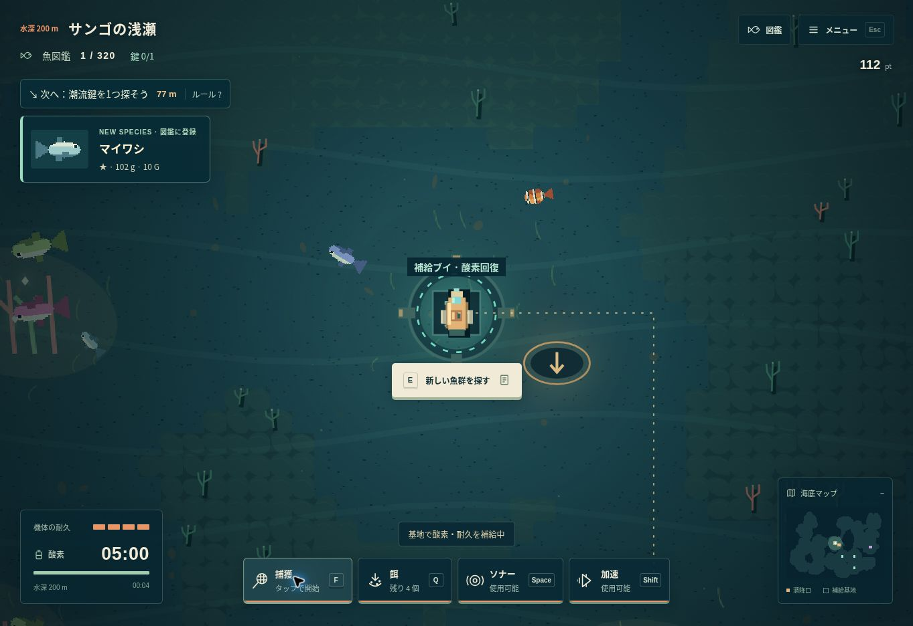

# NULL TIDE — 深層の記録

**[ゲームを遊ぶ](https://knutkning.vercel.app/)**

自然の海底洞窟を探索し、実在する魚320種の図鑑を埋めるブラウザゲーム。スマホは横向きで、左指の移動を維持したまま右指で捕獲・加速できます。


## 完成度アップデート (v5.0)



最初のマイワシを補給ブイの近くに置き、捕獲・鍵1つ・潜降の導線をつなぎました。魚のドット絵はフグ、ウツボ、サメ、ヒラメ、リボン状の魚など9系統のシルエットと種ごとの模様・色を使用。図鑑と泳ぐ魚が同じ絵を使います。浅瀬から熱水域まで6つの配色とランドマークで海を描き分けます。

- 採集カードに新種登録、希少度、個体重量、査定を表示。最大重量の自己記録・捕獲数・記録深度を保存。
- 図鑑5・15・40・80・160・240・320種で称号と研究助成金。重複受給を防止。
- 沈船・調査地点で12種の発見品を収集。深い海で新しい品が開放され、売却後もコレクションは残ります。
- 航海記録から到達深度・図鑑の進捗を共有。共有先はプレイヤーが選びます。
- 全到達済み深度をページ表示でワープ可能。浅瀬の商人へ直接帰還し、売却から強化へ進めます。「浅瀬から」でも装備・記録・到達済み深度を保持。
- 15秒ごとの自動保存、画面を離れる際の保存、予備セーブからの破損復旧。保存できない端末では引継ぎコードの保存を案内。
- ホーム画面追加用のWeb App ManifestとPNGアイコン。公開版でオフライン用データの準備が完了すると、通信なしでゲームを起動できます。引継ぎは通信が必要です。
- メニュー中の背景再描画と画面外の描画を削減。文字は端末の解像度を保ち、スプライトをキャッシュします。

## 海洋探索アップデート (v4.1)

- 123×89タイルの海域を、不規則な岩礁・入り江・砂地・曲がった洞窟で生成。等間隔の部屋・直角通路・床の格子・各部屋の人工施設を撤去しました。
- 各深度で「潮流鍵」を1つ回収、または古代神殿の謎を解くと次の潜降口が開きます。近場の鍵へ金色の点線と目標表示で案内します。追加の鍵・謎解きは任意です。鍵は接近して1回タップで回収します。
- 上昇口から300m浅い海へ自由に戻れます。開放済みの海域へは鍵を集め直さず再訪できます。
- 鍵、海図、調査地点、供給物資、捕獲済みの魚群を深度ごとに保存。上昇・再訪・再読み込みで保持します。
- 深度を初めて開拓すると1,000+深度番号×300ptと装備強化が得られます。再訪では重複支給しません。
- 捕獲報酬は深度ごとに+15%（最大5.5倍）。4深度開拓ごとに最大酸素+30秒・捕獲速度+15%、最大450秒・1.75倍。これらの能力は浅い海に戻っても残ります。
- 深度によって新たな魚が出現。全320種に遭遇・捕獲できます。捕獲後に補給ブイへ戻ると魚群を更新でき、未捕獲種を優先して配置します。
- 図鑑は和名・学名・科名で検索でき、捕獲済み・未捕獲・現在深度の魚で絞り込めます。1ページ24種のため、数千件を一度に描画しません。

## 魚のデータ

ENA taxonomyをGBIFから取得した実在魚3,000種の学名と分類に和名付きリストを統合したプールから、ゲームには320種を選んで収録しました。日本語名のない魚は学名を表示します。架空の和名や番号違いの魚で水増ししていません。

海水魚・淡水魚を含みます。出現深度、色、形、大きさ、行動、能力値はゲーム用の表現です。実際の生息環境や個別の解剖学的な外観を再現する図鑑ではありません。名称データはCC BY 4.0で、出典・取得方法は [DATA-SOURCES.md](DATA-SOURCES.md) に記載しています。画像は独自の簡略表現です。個体重量と希少度もゲームのバランス用の値で、生物学的な計測値や保全評価ではありません。

旧v3セーブの深度・装備・スコアを引き継ぎます。架空の魚の記録を実在種へ自動的に置き換えず、実在魚の図鑑は別の保存キーで開始します。以前の保存データも削除しません。

## 操作

| 操作 | PC | スマホ横向き |
| --- | --- | --- |
| 移動 | WASD・矢印 | 左側をドラッグ |
| 捕獲切替 | F | 捕獲を1回タップ |
| 加速 | Shift | 加速をタップ |
| 餌 / ソナー | Q / Space | 道具から選択 |
| 鍵の回収 / 潜降 / 上昇 | E | 接近時の画面下のボタン |
| 魚群更新 | 補給ブイでE | 捕獲後に補給ブイで表示されるボタン |
| 図鑑 / 鍵の海図 | J | 左上の魚マーク / 鍵の数 |
| 一時停止・設定 | Esc | 右上のメニュー |

捕獲は1匹ごとに自動解除。大きな音や高速の接近で魚が驚く場合は、餌や低速の接近を使います。補給ブイでは酸素と耐久を何度でも回復できます。メニュー中・縦持ち・画面離脱時には停止します。保存先はブラウザ内です。

## 開発・検証

外部ライブラリ、ビルド、フォント、画像APIは不要です。名称データも静的ファイルに同梱しています。

```sh
python3 -m http.server 8000 --directory dist
npm run check
npm test
```

`world.js` は描画から独立した60Hzのシミュレーション、`controls.js` は複数ポインターの独立入力、`render.js` はCanvas描画、`main.js` はDOM UIと保存、`species-data.js` は名称スナップショットです。

63件のテストで、300生成海域の接続性、鍵を集めながら25深度を実移動する経路、上下移動・再訪保存・報酬重複防止・全魚の遭遇可能性・同時タッチ入力を確認します。ブラウザでは和名検索、鍵の開放、潜降・上昇、スマホ表示を確認しています。

VercelはFramework Other、Output Directory `dist`、Build / Install Command空欄。静的ゲーム自体は環境変数不要。署名付きデータ引継ぎにはサーバー専用の NULL_TIDE_TRANSFER_KEY が必要です。

## 着想とクレジット

GitHub の小規模な実験作を調査し、以下の設計思想から着想を得ました。各作品のコード・画像・音声は転載していません。

- [NomanT17 / Echo-Pulse](https://github.com/NomanT17/Echo-Pulse): ソナーによる一時的な情報開示。README と `js/ping.js` を確認。
- [js13kGames / fear-the-dark](https://github.com/js13kGames/fear-the-dark): 光と暗闇が作る探索の緊張感。README と `javascript/dungeon.js` を確認。
- [igamerx / DungeonOfCurse_JS13K_24](https://github.com/igamerx/DungeonOfCurse_JS13K_24): 時間制約のある探索。README と `src/index.ts` を確認。

実装・ピクセル描画・音声は本プロジェクト独自制作。MIT License。

## 追加調整

鍵1つ、または古代神殿の碑文パズルで潜降。謎には答えのヒントがあり、失敗してもペナルティはありません。開拓済み深度へ自由にワープできます。生物を320種へ絞り、希少度5段階・サイズ別捕獲時間・個体の重さと査定額を追加。浅瀬の船大工ゲンさんに売り、エンジン・タンク・捕獲ネットを各5段階強化できます。

引継ぎコードはVercel FunctionsでHMAC-SHA256署名し、秘密鍵はサーバー環境変数 NULL_TIDE_TRANSFER_KEY に保管します。コードの書換えを検出しますが、クライアントが提出した状態に署名するため、ブラウザ内のプレイデータ改造まで防ぐ権威サーバーではありません。コードを知る人は復元できます。


## 読みやすさ・導入の改善 (v4.1)

初回出航時に、進行・操作・帰還と強化を分けたガイドを表示します。探索中の「次へ / ルール」と休憩メニューからいつでも再表示でき、読んでいる間は酸素が減りません。

Canvasを画面の半分の解像度で描く方式を廃止し、端末の画素密度（最大2倍）で描画。魚・機体のドット表現は残し、魚名や施設名は霧の上へ14pxの固定サイズで描きます。スマホの説明文・図鑑・ボタン文字も拡大しました。既存の図鑑・積み荷・装備・開拓済み深度はそのまま引き継ぎます。

## v5の確認範囲

63件の自動テストで、初回の捕獲、重量記録の署名付き引継ぎ、収集報酬の重複防止、発見品の売却・再訪、研究報酬の再取得防止、保存破損・容量不足、全スプライト、オフライン資源とAPI除外を含めて確認。既存の300海域接続性・25回連続潜降・複数指入力の検証も維持します。

ブラウザーでは初回捕獲・採集カード・記録、844×390と568×320の横画面、売却・装備購入、深海から商人へのワープを確認しています。実機の全ブラウザーや大規模な同時接続・ストア審査を保証するものではありません。ゲーム本体は静的配信で、共有・インストールはブラウザーの対応状況によります。
