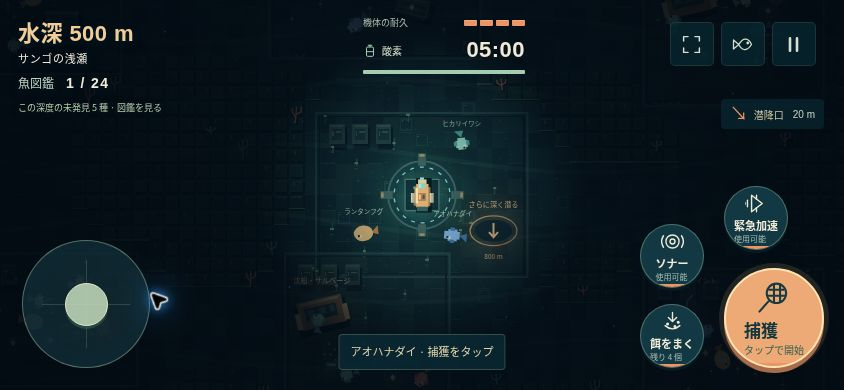

# NULL TIDE — 深層の記録

深海へ潜り続け、全24種類の魚図鑑を完成させる海底探索ゲーム。ブラウザだけで遊べます。

**[ゲームを遊ぶ](https://knutkning.vercel.app/)**



## 深海図鑑アップデート (v3.0)

- スマホは横向き。左下の広いエリアをドラッグして移動、右下の直径100pxの捕獲ボタンをタップします。餌・ソナー・加速はそれぞれ64pxのボタンです。
- 捕獲は1回タップで開始し、1匹捕まえると自動で解除。調査・潜降も1回押すだけで、長押しは不要です。
- 縦持ちの間はゲームを停止して横向きの案内を表示。対応ブラウザでは全画面表示と横向き固定も利用できます。
- 水深200mから300mずつ潜降。3海域での終了をなくし、図鑑完成後も探索を続けられます。遺跡の記録回収は任意です。
- 生きものは全24種類。深度で出会える種類が変わり、最後の種類は5,900mから現れます。図鑑には未発見の種類の生息開始深度も載っています。
- 図鑑・到達深度・装備・潜航の記録を自動保存。再読み込み・失敗の後も、保存した深度の基地から再開できます。途中の機体位置や各地点の回収状況はリセットされます。
- 「浅瀬から」で200mからやり直せます。集めた魚図鑑はそのまま残ります。

## 探索と捕獲

各深度に `123 × 89` タイルの生成マップ、21地点、63匹の生きものが現れます。基地と潜降口は中央付近にあり、分岐と回遊路の先には沈船・調査ポイント・遺跡が隠れています。

静かに近づいて捕獲を開始します。網を構えている間は低速になり、近くの魚を自動で捕まえます。ソナー・急加速・速い接近は魚を驚かせるため、餌で落ち着かせておびき寄せるのが効果的です。魚ごとに速さ・希少性・捕獲時間が異なります。

- 1深度で3匹捕まえると調査依頼達成：650pt、餌2個、酸素40秒。
- 沈船では餌・酸素・修理、調査ポイントでは餌・酸素・海図の更新が得られます。
- 酸素タンクは5分。中央の基地は酸素と耐久を何度でも回復します。
- ソナーは暗闇の地形を照らす一方、監視機を引き寄せます。加速中は無敵で、監視機を一時停止させられます。
- 潜降時はエンジン・ソナー・酸素タンクの強化を選び、酸素・耐久・餌を補給します。強化の上限に達しても潜降できます。
- 図鑑と大きな海図を開いている間は一時停止。深度にいる未発見種の数もHUDで確認できます。

## 操作

| 操作 | キー / スマホ |
| --- | --- |
| 移動 | WASD・矢印キー / 左下をドラッグ |
| 捕獲のオン・オフ | F / 大きな捕獲ボタンをタップ |
| 餌をまく | Q / 餌ボタン |
| ソナー | Space / ソナーボタン |
| 緊急加速 | Shift / 加速ボタン |
| 調査・さらに深く潜る | E / 接近時の中央ボタンをタップ |
| 図鑑・海図 | J / 右上の魚アイコン |
| 一時停止 | Esc / 右上の一時停止ボタン |

フォーカスを離れると自動で停止します。音の切替・動きを抑える設定にも対応。保存先はこのブラウザ内で、アカウント登録や外部サービスは不要です。

## ローカル実行

外部ライブラリ・ビルド・外部画像・外部フォントは不要です。ES Modules を使うため、HTTP サーバー経由で開いてください。

```sh
python3 -m http.server 8000 --directory dist
# http://localhost:8000 を開く
```

Node.js 20 以降で検証できます。

```sh
npm run check
npm test
```

## Vercel へのデプロイ

`vercel.json` に静的サイト用の設定を含めています。Framework は Other、Output Directory は `dist`、Build Command と Install Command は空欄です。環境変数は不要です。

## 構造

| ファイル | 役割 |
| --- | --- |
| `dist/src/world.js` | 生成、衝突、魚・監視機、捕獲、補給、連続潜降、チェックポイント |
| `dist/src/render.js` | ピクセル描画、カメラ、水中光、ソナー波、海図 |
| `dist/src/main.js` | 固定ステップ、タップ操作、UI、図鑑・進行保存、画面遷移 |
| `dist/src/controls.js` | 親指入力の正規化、縦向き判定 |
| `dist/src/species.js` | 全24種のデータ、生息深度、図鑑イラスト |
| `dist/src/audio.js` | Web Audio の環境音・効果音 |
| `dist/assets/` | 独自のカバー・潜水艇・アイコン |
| `tests/world.test.mjs` | 生成海域の到達性、操作による25回の連続潜降 |
| `tests/ecology.test.mjs` | 捕獲・餌・報酬・基地補給・深度別の生きもの |
| `tests/diving.test.mjs` | 図鑑完成、深度・装備の保存、強化上限、親指入力 |

ゲームルールは描画から独立し、60Hzの固定ステップで更新します。操作UIは844×390、568×320の横向き表示と390×844の縦向き案内をブラウザで確認しています。

## 着想とクレジット

GitHub の小規模な実験作を調査し、以下の設計思想から着想を得ました。各作品のコード・画像・音声は転載していません。

- [NomanT17 / Echo-Pulse](https://github.com/NomanT17/Echo-Pulse): ソナーによる一時的な情報開示。README と `js/ping.js` を確認。
- [js13kGames / fear-the-dark](https://github.com/js13kGames/fear-the-dark): 光と暗闇が作る探索の緊張感。README と `javascript/dungeon.js` を確認。
- [igamerx / DungeonOfCurse_JS13K_24](https://github.com/igamerx/DungeonOfCurse_JS13K_24): 時間制約のある探索。README と `src/index.ts` を確認。

実装・ピクセル描画・音声は本プロジェクト独自制作。MIT License。
